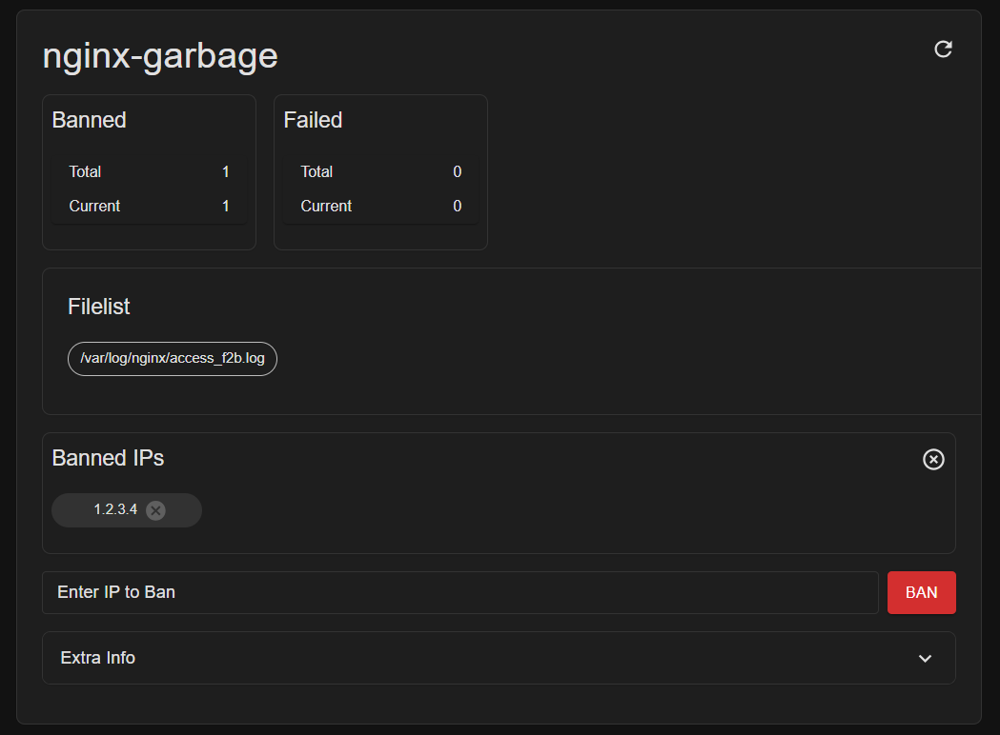

# Fail2ban Web Control

[](https://github.com/oweitman/fail2bancontrol/actions/workflows/dockerhub.yml)
[](https://github.com/oweitman/fail2bancontrol/issues)
[](https://github.com/oweitman/fail2bancontrol/pulls)<br>
[](https://hub.docker.com/r/oweitman/fail2bancontrol)
[](https://hub.docker.com/r/oweitman/fail2bancontrol)
[](https://hub.docker.com/r/oweitman/fail2bancontrol)
[](https://hub.docker.com/r/oweitman/fail2bancontrol)<br>
[](https://github.com/oweitman/fail2bancontrol)
[](https://github.com/oweitman/fail2bancontrol)
[](https://github.com/oweitman/fail2bancontrol/network)
[](https://github.com/oweitman/fail2bancontrol/stargazers)


## Introduction

Fail2ban Web Control is a lightweight web-based control panel for managing Fail2ban.

It allows you to:

- View global Fail2ban status
- Inspect jails and their metrics
- Ban and unban IP addresses
- Control Fail2ban server actions




The application communicates directly with the Fail2ban UNIX socket.

---

## Installation

Choose one of the following:

- [👉 Docker Hub image → see](documentation/InstallDockerhubDocker.md)
- [👉 Docker Image build locally → see](documentation/InstallGithubDocker.md)
- [👉 Local install without docker → see](documentation/InstallLocalNoDocker.md)

---

## Features

### Jail Overview

- Current and total failed attempts
- Current and total banned IPs
- List of monitored log files
- Ban / unban IPs
- Extra jail parameters (bantime, findtime, etc.)

### Log File Access

If log files are mounted into the container, they can be viewed and monitored.

---

## API

Full API documentation:

[👉 API → see](documentation/API.md)

---

## Notes & Troubleshooting

### Permission issues

If you see:

```
Permission denied
```

Ensure the process/container has access to the Fail2ban socket.

---

### Socket verification

```bash
docker exec -it fail2bancontrol ls -l /var/run/fail2ban
```

---

### Port behavior

- Internal: `9000`
- External: defined via Docker (`9191:9000` in examples)

---

## Changelog

<!-- CHANGELOG:INSERT -->

- restore old changelog
- insert screenshot
- no functional changes

### v1.9.1 — 2026-04-04

- rework readme
- add documentation local install without docker
- no functional changes

### v1.9.0 — 2025-11-10

-   optimize overview requests
-   add short time caching for some values
-   more error details in api responses
-   add jail extra infos in frontend and api
-   little css improvement

### v1.8.0 — 2025-09-03

-   add more api endpoints
-   add server control buttons start, stop, restart, reload
-   change theme switch button
-   add server version
-   add dbfile location
-   add log level slider
-   add dbmaxmatches
-   add dbpurgeage
-   add eslint
-   fix eslint errors
-   improve refresh between overview and jails
-   improve design
-   add testscript for banned ips
-   add some more documentations

### v1.5.1 — 2025-08-28

-   recreate frontend sources
-   improve release script

### v1.5.0 – 2025-08-28

-   add version
-   add workflow actions for release and version

### Version 1.4.0

-   improve backend logic für prod and dev
-   add footer with links

### Version 1.3.0

-   automate docker push

### Version 1.2.0

-   Feature FileView

### Version 1.1.0

-   Move gui to mui/react

### Version 1.0.0

-   Initial release